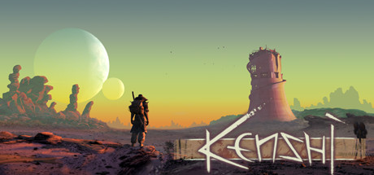

**Kenshi by Lo-Fi Games (2018) is a squad-based open-world RPG set in a post-apocalyptic desert.**

---

## 📖 About

Kenshi by Lo-Fi Games (2018) is a squad-based open-world RPG set in a post-apocalyptic desert. There are no quests, no map markers, no hand-holding — just brutal survival where you start as a nobody and build toward faction dominance. The learning curve is a cliff.

## ⚠️ Problems Without Trainer

| Problem | Status |
|---------|--------|
| Starting characters die to bandits within minutes with no early income | ✅ Solved |
| Hunger and blood loss kill squad members faster than healing can respond | ✅ Solved |
| Building research locked behind materials that enemies guard aggressively | ✅ Solved |
| Slavers capture unconscious party members erasing days of progress | ✅ Solved |
| Tech tree progression requires thousands of cats to advance meaningfully | ✅ Solved |

## ✅ Solution

The **Kenshi Trainer** solves all these issues, giving you complete control so you can focus on enjoying the game.

## 🎯 Features

- Unlimited Resources / Currency
- God Mode / Invincibility
- Instant Skill & Ability Cooldown
- One-Hit Kill
- Freeze Timers
- Unlock All Items & Achievements
- Custom Speed Multiplier
- Infinite Stamina / Energy

## 🚀 Quick Start

1. **Disable Windows Defender** temporarily (trainer may trigger false positive)
2. Get the trainer from the button above
3. Launch Kenshi
4. Run the trainer as Administrator
5. Use the hotkeys to activate cheats in-game

## 💎 Free vs Pro

| Feature | Free | Pro |
|---------|------|-----|
| God Mode | ✅ | ✅ |
| Unlimited Resources | ✅ | ✅ |
| Advanced Cheats | ❌ | ✅ |
| Auto-Updates | ❌ | ✅ |
| Priority Support | ❌ | ✅ |

## 💻 Requirements

- Windows 10 / 11 (64-bit)
- Kenshi (any version)
- .NET Framework 4.8+
- DirectX 11+

## 🍎 macOS

## ⚖️ Legal

Educational and single-player use only.

---

